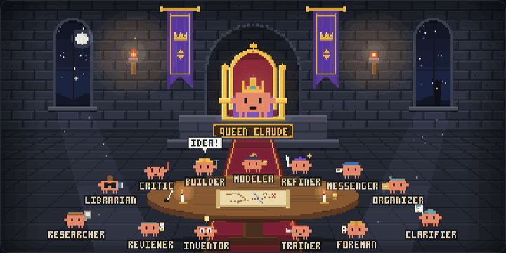
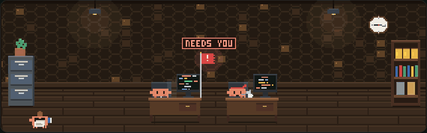
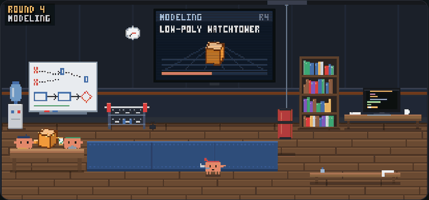
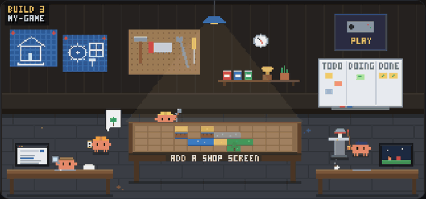
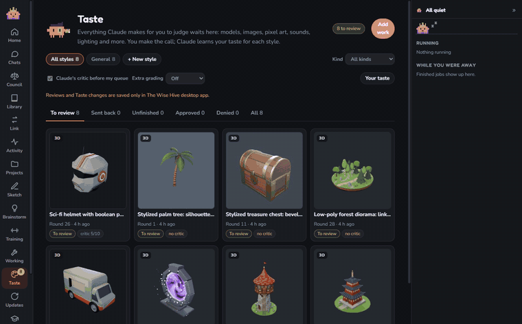

# The Wise Hive

**Long-term memory and a team of agents for Claude on your Windows PC.** Two editions, two folders: 📁 **[1-wise-hive](1-wise-hive)** (full) and 📁 **[2-wise-hive-lite](2-wise-hive-lite)** (uses far less Claude usage).

## Install

> **Install only ONE edition: the full one or Lite, not both.** They're two versions of the same app, so you only need one. Both work on any Claude plan. On **Max**, the full edition works best; if you want your usage to go further, pick **Lite** ([compare them below](#which-one)). Changed your mind later? Just install the other one: it replaces the first and keeps everything you've taught it.

**Size:** the same for both editions. The download from GitHub is small (about 2-6 MB). During setup the installer also downloads the desktop app's engine (Electron, about 150 MB), so plan for **about 550 MB of disk space** in total. If Node.js or the Claude Code CLI aren't on your PC yet, `-InstallMissing` downloads those too.

**Easiest:** open the **Claude desktop app**, start a chat in the **Code** tab, and paste one of these:

> Install The Wise Hive from https://github.com/darrenaccount/wise-hive/tree/main/1-wise-hive

> Install The Wise Hive Lite from https://github.com/darrenaccount/wise-hive/tree/main/2-wise-hive-lite

Claude asks where to keep the memory folder and does the rest (about 5 minutes). Then start a new chat and you're set.

**Or in PowerShell**, run one line:

The Wise Hive:
```powershell
& ([scriptblock]::Create((irm https://raw.githubusercontent.com/darrenaccount/wise-hive/main/1-wise-hive/get.ps1))) -InstallMissing
```

The Wise Hive Lite:
```powershell
& ([scriptblock]::Create((irm https://raw.githubusercontent.com/darrenaccount/wise-hive/main/2-wise-hive-lite/get.ps1))) -InstallMissing
```

**Or download it:** click the green **Code** button above → **Download ZIP** (it holds both editions), unzip it, open only the ONE folder you want (`1-wise-hive` or `2-wise-hive-lite`), click the folder's address bar, type `powershell` and press Enter, then run:

```powershell
powershell -ExecutionPolicy Bypass -File .\install.ps1 -InstallMissing
```

Step-by-step guides: [1-wise-hive/INSTALL.md](1-wise-hive/INSTALL.md) · [2-wise-hive-lite/INSTALL.md](2-wise-hive-lite/INSTALL.md). You need Windows 10 or 11 and a Claude account.

## Which one?

| | 📁 **[1-wise-hive](1-wise-hive)** | 📁 **[2-wise-hive-lite](2-wise-hive-lite)** |
|---|---|---|
| What it is | The full edition: every helper agent at full power | The same app and memory with lighter helpers that run less often |
| Good for | Any plan, and works best on Max: every helper at full power | Any plan, when you want your usage to go further or you use Claude a lot for other things |
| Claude usage | More: the helpers are extra Claude runs | Far less: about 7× fewer tokens per helper run |
| Download and disk space | ~2-6 MB download, then ~150 MB for the app engine during setup; ~550 MB on disk | The same |
| Your main chats | Full Claude Code power | **Identical**, only the helpers around them are lighter |
| Memory, transcripts, app, skills | ✓ | ✓ (identical) |
| Memory loaded when a chat starts | Everything (~72,000 characters: index, lessons, knowledge notes) | The essentials (~8,600 characters); matching notes still arrive with every message |
| Each helper run starts with | ~45,000 tokens (every tool, MCP server, skill and hook) | ~6,000 tokens (only what the helper needs, plus your memory index) |
| Clarifier (catches misunderstandings) | Every message, Sonnet, up to 4 questions | First message of a chat or long prompts, Haiku, up to 2 questions |
| Inventor (Claude's take + next ideas) | After every reply, Sonnet, up to 3 ideas | When you press Get ideas, Haiku, up to 2 ideas |
| Council | 1 run per seat + the Judge, up to 13 seats | Trimmed Sonnet runs, 1-5 seats + the Judge |
| Training and Working rounds | Your default model, up to 80 turns, up to 3 helper agents | Sonnet unless you pick one, up to 30 turns, 1 helper agent |
| Planner that picks each round's task | Sonnet | Haiku |
| The Boss (grades every round) | On at 8/10, up to 2 redos per task | Off until you turn it on, 1 redo per task |
| Skillsmith (lessons → new skills) | Also runs by itself after 15 new lessons | When you press Find new skills |
| Questions from Obsidian | A full Claude chat | A small read-only helper |
| Usage guard for the overnight loops | Pauses at 97% of your plan limit | Pauses at 75% |
| Following Claude Code updates | Automatic, with rollback | You press Re-adapt |
| Read more | [1-wise-hive/README.md](1-wise-hive/README.md) | [2-wise-hive-lite/README.md](2-wise-hive-lite/README.md) |

You only need one. Both use the same brain folder, so you can switch any time by installing the other one: it replaces the first, and everything you've taught it stays.

## Take a look

The desktop app is a little pixel-art castle. Each tab has its own room, and the Claudes in it show what's happening right now.

| | |
|---|---|
|  | **Home.** Queen Claude and the hive's agents. Type what you want and press Start chat to get a full-power Claude chat in the project folder you pick. Tap any Claude to see what it does. The line under the scene shows how much the hive remembers. |
|  | **Council.** Pitch an idea and your council argues it: by default a Believer, a Skeptic and an Investor, and you can add seats like a Playtester, a Roblox economist or a Competitor. Then the Judge rules PURSUE, PIVOT or PASS with a score. Every debate is saved. |
|  | **Library.** Everything the hive remembers: memories, skills and lessons, past conversations and prompts. The Librarian reads new chats and files the lessons, each linked to the chat it came from. The Organizer fixes misfiled notes, and the Trimmer shortens them without losing detail. |
|  | **Activity.** Everything Claude is doing right now, across every chat, background agent and handoff. Anything waiting for you, like a permission question, is at the top. Finished jobs show up in "while you were away". |
|  | **Training.** Your agents practise on their own, even overnight: Blender modeling, Roblox scripting, research and bug fixing. They watch YouTube tutorials, rebuild what they teach and save the lessons for every future chat. The Boss grades each round, and it pauses before your usage limit. |
|  | **Working.** The crew keeps improving one of your projects while you're away, on a safe git branch. Every round gets a card with its changes and the Boss's grade, and you press Keep or Discard. It runs until you press End. |
|  | **Taste library.** Everything the agents make lands here for you to judge. Shown: a pagoda and an animated magic portal that Training built in Blender from tutorials Claude researched on its own. Models spin, animations play as loops, and the notes say what Claude learned and what went wrong. Press Approve, Deny or Comment. Comments send the work back for a better version, and your reasons teach Claude your style. |

## It never stops learning

**The Wise Hive is a continuously adapting, learning app. It learns from every prompt you send.** Normal Claude forgets everything when a chat ends. The Wise Hive keeps what each chat teaches it and gets better the more you use it:

- **Every conversation is saved.** When a chat ends, a readable copy goes into your brain folder, from the Claude desktop app, Claude Code in a terminal or The Wise Hive app.
- **Every prompt brings back what matters.** Each message you send is matched against your memory, and the notes and lessons that fit it are handed to Claude with it. Ask about a project from last month and Claude already knows its folders, decisions and past mistakes.
- **Lessons, not just logs.** The Librarian reads new conversations and files the lessons: what worked, what broke, the exact error and the fix. Each lesson links back to the chat it came from, so Claude never has to learn the same thing twice.
- **It writes its own skills.** The Skillsmith looks through everything the hive has learned. When a way of working has been proven in 3 or more separate lessons, it turns that into a real Claude skill that every future chat uses on its own. A second, independent Claude grades each new skill, and only 8/10 or better is kept. The full edition does this by itself after every 15 new lessons, and you can remove any skill with one click.
- **It practises while you sleep.** Training rounds pick your weak spots, learn from YouTube tutorials, rebuild what they teach and save the lessons for every future chat.
- **It learns your taste.** Approve, deny or comment on what it makes in the Taste library. It learns your style from your reasons, and comments send the work back for a better version.
- **It learns how you ask.** The Refiner keeps a library of your prompts and how it improved them, so its rewrites fit the way you work.
- **It keeps up with Claude.** When Claude Code updates, The Wise Hive adapts itself to the new version and rolls back if anything breaks.

## Every feature

**🧠 Memory (the brain folder)**
- One folder on your PC (default `%USERPROFILE%\ClaudeBrain`) holds Claude's memories, project notes, lessons, knowledge files, skills and a readable copy of every conversation.
- Every new chat reads it first, wherever you use Claude.
- Your existing Claude memories and past chats are copied in when you install.
- It opens as an **Obsidian vault**, with a plugin to ask The Wise Hive questions straight from your notes.
- Plain files you can read, edit and back up. Nothing is uploaded.

**💬 Chats**
- Full-power Claude Code chats in any project folder, with permission questions answered right in the chat (Allow, Deny or pick an answer).
- Pictures and files Claude makes show up in the chat. There's also chat search, a sketch board Claude can read, and a "while you were away" summary.
- Optional helpers: the **Refiner** sharpens rough prompts, the **Clarifier** catches what's unclear before work starts, and the **Inventor** gives an honest take and next ideas.
- **Link** talks to your Claude desktop app chats: hand work back and forth between them.

**⚖️ Council and 💡 Brainstorm**
- The Council debates any idea with up to 13 seats (Believer, Skeptic, Investor, Playtester, Roblox economist, Engineer, Competitor, Marketer and more), and a Judge rules PURSUE, PIVOT or PASS with a score.
- Brainstorm researches an idea with you and writes a plan without building anything.

**🏋️ Training and 🔧 Working (they keep going while you're away)**
- **Training** practises real skills non-stop: Blender modeling, Roblox scripting and VFX, research, bug fixing. You choose the subjects and the Claude model.
- **Working** keeps improving one of your projects on a safe git branch. Every round gets a card with its changes, pictures and an undo, and you press Keep or Discard.
- **The Boss** grades every round out of 10 from the real result (the code, or the renders it made). Weak work is sent back with an exact list of fixes. Choose a bar of 7, 8 or 9, or turn it off.
- **Usage guards:** they pause near your plan limit, and you can set daily caps, quiet hours and pausing while you game.

**🎨 Taste library**
- Everything the agents make for you to judge, ready to look at: 3D models become colour turntables you can spin, animations and VFX play as looping videos, web pages show as pictures, and code is one click away.
- A critic checks each piece before it reaches you. Your verdicts teach Claude your style, one style at a time.

**📚 Library**
- Browse memories, skills and lessons, conversations, prompts and memory health.
- The **Librarian** files new lessons, the **Organizer** fixes misfiled notes and merges duplicates (every move can be undone), the **Trimmer** shortens notes without losing detail, and the **Skillsmith** turns proven lessons into skills.

**🧩 Skills and plugins**
- Every agent also works as a Claude skill in any chat: `/wise-hive:council`, `:brainstorm`, `:train`, `:work`, `:refine`, `:clarify`, `:ideas`, `:tidy`, `:organize`, `:updates`, plus Blender modeling.
- Browse, install and switch Claude Code plugins from the app.

**🏰 The app itself**
- A pixel-art castle where each tab is a room and the Claudes act out what's happening.
- An activity panel shows everything running and anything waiting for you.
- It lives in the tray, starts with Windows, restarts itself if it stops, and sends Windows notifications.

Everything runs on your own PC with your own Claude account, and nothing is uploaded anywhere by The Wise Hive.

Made by [darrenaccount](https://github.com/darrenaccount). MIT licensed.
